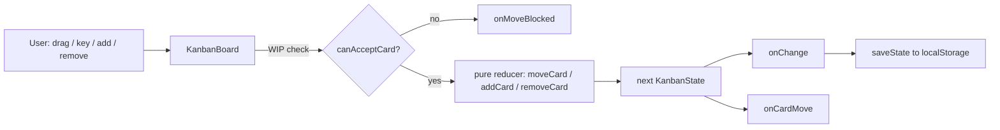

<div align="center">


# react-kanban-board

### A lightweight, dependency-free Kanban board for React — drag & drop, WIP limits, labels, priority, and persistence.

**Built and maintained by [Viprasol Tech](https://viprasol.com)**

[](https://www.npmjs.com/package/react-kanban-board)
[](LICENSE)
[](https://www.typescriptlang.org/)
[](https://react.dev/)
[](#-testing)
[](#-features)

</div>

---

## ✨ Features

- 🧲 **Native drag & drop** — move cards **between** and **within** columns, with the exact drop index.
- 🚦 **WIP limits** — cap each column; over-limit moves/adds are rejected and surfaced via `onMoveBlocked`.
- 🏷️ **Labels & priority** — colour-chip labels and a `low → urgent` priority badge, with weights for sorting.
- ✏️ **Editable mode** — inline "+ Add card" input and per-card delete button.
- ⌨️ **Keyboard accessible** — focus a card and reorder with ArrowUp / ArrowDown; ARIA roles throughout.
- 💾 **Persistence helpers** — `saveState` / `loadState` over any `StorageLike` (defaults to `localStorage`), with a runtime shape guard.
- 🧪 **Pure reducers** — all mutations are pure, immutable, and unit-testable in isolation.
- 🔁 **Controlled or uncontrolled** — single `onChange` for persistence, plus a detailed `onCardMove`.
- 🟦 **Strict TypeScript**, **zero runtime dependencies**, React 18+.

## 📦 Install

```bash
npm install react-kanban-board
# or
pnpm add react-kanban-board
# or
yarn add react-kanban-board
```

`react` and `react-dom` (>=18) are peer dependencies.

## 🚀 Usage

```tsx
import { useState } from "react";
import {
  KanbanBoard,
  createColumn,
  createCard,
  saveState,
  loadState,
  type KanbanState,
} from "react-kanban-board";

const STORAGE_KEY = "my-board";

const initial: KanbanState = loadState(STORAGE_KEY) ?? [
  createColumn("todo", "To Do", [
    createCard("a", "Design API", { priority: "high", labels: [{ name: "spec" }] }),
    createCard("b", "Write tests", { priority: "medium" }),
  ]),
  createColumn("doing", "In Progress", [], 2), // WIP limit of 2
  createColumn("done", "Done", []),
];

export function MyBoard() {
  const [columns, setColumns] = useState<KanbanState>(initial);

  return (
    <KanbanBoard
      columns={columns}
      editable
      onChange={(next) => {
        setColumns(next);
        saveState(STORAGE_KEY, next); // persist on every change
      }}
      onCardMove={(_next, move) =>
        console.log(`${move.cardId}: ${move.fromColumn}[${move.fromIndex}] -> ${move.toColumn}[${move.toIndex}]`)
      }
      onMoveBlocked={(cardId, toColumn) =>
        alert(`"${toColumn}" is at its WIP limit`)
      }
    />
  );
}
```

> The board ships **unstyled** (semantic class names only) so it inherits your design system. Target `.kanban-board`, `.kanban-column`, `.kanban-card`, `.kanban-column--full`, `.kanban-card--urgent`, etc.

## 🧩 API

### `<KanbanBoard />` props

| Prop | Type | Default | Description |
| --- | --- | --- | --- |
| `columns` | `KanbanState` | — | Columns to render. Treated as initial state when uncontrolled. |
| `controlled` | `boolean` | `false` | Render `columns` exactly and never hold internal state. |
| `editable` | `boolean` | `false` | Show the add-card control and per-card delete button. |
| `onChange` | `(next: KanbanState) => void` | — | Fires after **any** successful mutation. Canonical persistence hook. |
| `onCardMove` | `(next: KanbanState, move: CardMove) => void` | — | Fires after a successful move with detailed `CardMove`. |
| `onMoveBlocked` | `(cardId, toColumn, reason) => void` | — | Fires when a mutation is rejected (e.g. WIP limit). |
| `renderCard` | `(card: KanbanCard) => ReactNode` | — | Custom renderer for a card body. |
| `createCardFromInput` | `(columnId, title) => KanbanCard` | `crypto.randomUUID` | Mints a card from the add-card input. |
| `className` | `string` | — | Extra class on the board container. |

### Types

| Type | Shape |
| --- | --- |
| `KanbanCard` | `{ id; title; description?; priority?; labels? }` |
| `KanbanColumn` | `{ id; title; cards; wipLimit? }` |
| `KanbanState` | `KanbanColumn[]` |
| `CardLabel` | `{ name; color? }` |
| `CardPriority` | `"low" \| "medium" \| "high" \| "urgent"` |
| `CardMove` | `{ cardId; fromColumn; fromIndex; toColumn; toIndex }` |
| `BlockReason` | `"wip-limit"` |

### Pure helpers

| Function | Description |
| --- | --- |
| `moveCard(state, cardId, toColumn, toIndex)` | Move a card; respects WIP limits; immutable. |
| `addCard(state, columnId, card)` | Append a card; rejects duplicates & over-limit. |
| `removeCard(state, cardId)` | Remove a card from anywhere. |
| `updateCard(state, cardId, patch)` | Shallow-merge a card patch (id immutable). |
| `addColumn / removeColumn / updateColumn / moveColumn` | Column CRUD + reorder. |
| `sortColumnByPriority(state, columnId, dir?)` | Stable sort a column by priority. |
| `findCard / findColumn / isColumnFull / canAcceptCard / countCards / clampIndex` | Queries & utilities. |
| `createColumn / createCard` | Ergonomic constructors. |

### Persistence

| Function | Description |
| --- | --- |
| `saveState(key, state, storage?)` | Serialise & persist; returns `false` if unavailable. |
| `loadState(key, storage?)` | Parse & **shape-validate**; returns `null` if invalid. |
| `clearState(key, storage?)` | Remove a persisted entry. |
| `isKanbanState(value)` | Runtime guard for board JSON. |

## 🗺️ Data flow



## 🧪 Testing

```bash
npm install
npm run typecheck   # tsc --noEmit, zero errors
npm test            # vitest run, 87 tests
```

Logic is tested as pure functions; the component is tested with
`@testing-library/react` (render + drag/keyboard/edit interaction).

## ✅ Roadmap

- [x] Drag between & within columns with precise index
- [x] WIP limits per column
- [x] Add/remove cards & columns
- [x] Card labels & priority
- [x] `onChange` callback + persistence helper
- [x] Keyboard reordering & ARIA roles
- [ ] Swimlanes (horizontal grouping)
- [ ] Virtualised columns for very large boards
- [ ] Drag handles & touch-pointer fallback
- [ ] Optional default stylesheet / theme tokens

## ❓ FAQ

**Does it require a drag-and-drop library?**
No. It uses native HTML5 drag & drop and has zero runtime dependencies.

**Controlled or uncontrolled?**
Both. Omit `controlled` to let the board manage state and read `onChange`; pass
`controlled` to drive `columns` yourself from `onChange` / `onCardMove`.

**How do WIP limits behave?**
Set `wipLimit` on a column. Cross-column moves and adds that would exceed it are
rejected (state unchanged) and reported via `onMoveBlocked`. Reordering **within**
a full column is always allowed.

**Can I persist to something other than `localStorage`?**
Yes — pass any `StorageLike` (`getItem`/`setItem`/`removeItem`) to the helpers,
e.g. `sessionStorage` or an in-memory stub for SSR/tests.

## 🤝 Contributing

Contributions are welcome! Please open an issue to discuss substantial changes
first. Run `npm run typecheck` and `npm test` before submitting a PR, and keep
the strict-typed, zero-dependency, no-stubs philosophy intact. See
[CONTRIBUTING.md](CONTRIBUTING.md) and our [Code of Conduct](CODE_OF_CONDUCT.md).

## Contact — Viprasol Tech Private Limited

- Website: [viprasol.com](https://viprasol.com)
- Email: [support@viprasol.com](mailto:support@viprasol.com)
- Telegram: [t.me/viprasol_help](https://t.me/viprasol_help) | WhatsApp: +91 96336 52112
- GitHub: [@Viprasol-Tech](https://github.com/Viprasol-Tech) | [LinkedIn](https://www.linkedin.com/in/viprasol/) | X [@viprasol](https://twitter.com/viprasol)

## License

[MIT](LICENSE) (c) 2025 Viprasol Tech Private Limited
